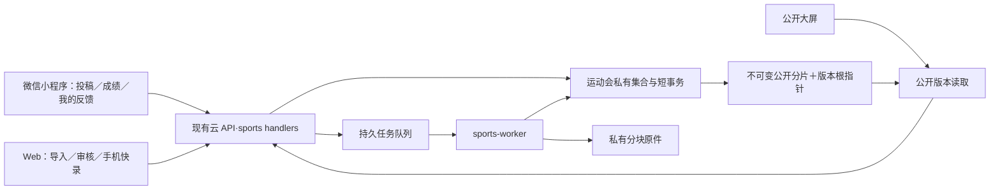

# 运动会收稿、实时成绩与大屏 Plan

日期：2026-10-14。依据：主 spec.md、scoreboard-spec.md，以及用户同意补充功能、要求继续和批注加入纠错／大屏的指示。本文为可实施技术设计，待审查与用户审阅；本轮不编写业务代码、不部署。

## 1．架构与现状约束

正式实现位于现有云函数、Vue 管理后台和微信小程序。运动会使用独立集合、服务、接口和客户端门面，不扩展旧 submit.type，不调用点歌周配额、调剂及排期算法。direct 模式显示运动会暂不可用，不静默读 Express／MySQL；其他原业务的双通道保持。

复用当前 JWT 身份、北京时间工具、ExcelJS 依赖、Web UI 组件和云函数构建发布框架。运动会管理员入口额外读取管理员当前 status／role，已停用或已删除账号拒绝，角色以当前记录为准；不全局改旧鉴权。学生使用稳定 uid 归属和原有 pv 校验，不把学号更名当作另一个投稿人。原生云调用的 ctx.openid 用于内容检查，JWT.openid 仍是业务学号，两者不可混用。

现有云 Web HTTP 文件请求约 100 KB 限制来自仓库实测，现有头像是公开读路径。运动会不能把 20 MiB PDF 或成绩单塞进现有 FormData/base64 上传。原 lib/db.nextId 的自增与读取分离，新模块改用独立固定文档事务分配编号，不修改旧号源。

模块依赖为 handlers → application services → store／纯校验与计算；store 不依赖业务 services。公开投影 publisher 依赖结果、积分、晋级计算器的纯输入输出，不反向调用 handlers。长任务由独立 sports-worker 云函数消费队列。

## 2．统一类型、状态与不变式

`Id` 为正安全整数，文档 `_id` 为固定字符串键，不能把云 `_id` 当用户编号。`Rev` 为从 1 起递增的整数；`TimeMs` 为 UTC epoch 毫秒，日历运算及展示均经 bjTime；`DateKey` 为北京时间 YYYY-MM-DD。分数存整数百分之一分，倍数存整数百分之一倍。所有字符串限制、文件大小、字符计数及状态边界沿对应 spec 校验。

所有变更使用 `Command<T>={operationId:UUID,expectedRev:Rev,expectedGateRev:Rev,payload:T}`；创建对象 expectedRev=0。幂等键含操作者、活动、操作类型和 operationId，保存 payloadHash。重复键同 payload 返回原回执，不同 payload 返回冲突；成功回执的安全重试先于当前窗口校验，避免首次成功但过截止后取不到回执。返回 `MutationResult={id,rev,state,publicSeq?:number,jobId?:Id}`，返回字段按操作确定。

<!-- review-fix: PLAN-ISSUE-2 -->
`payload` 的线上传输统一为 `inline:T` 或 `payloadRef:{stagingId,kind,schemaVersion,sha256,byteLength,rowCount}`，服务层收到的是已解析校验的 T。新增接口每次完整JSON请求按UTF-8序列化不得超过80KiB，客户端超过48KiB的业务正文必须走临时负载协议，不能等网关413才截断。该协议覆盖5000行粘贴文本、200人成绩草稿、赛程／时段批量修订、名册行、导入选中行与冲突解决清单；学生单篇正文及反馈在现有字段上限内走inline。

临时负载限定当前管理员、活动、负载类型及schema：创建上传会话→按48KiB原始字节上传有序块→校验整体hash／字节数→由PAYLOAD_VALIDATE任务重建、解析并校验字段／行数→标记VALIDATED及规范化数据块引用→最终Command仅提交payloadRef和版本。最大64MiB，所选模板有效字段仍执行各自上限，不把无关列或无限字符串当作合法成绩。粘贴文本采用PASTED_TSV，其他用JSON；文件本身20MiB／10MiB上限不因此放宽。服务端必须验证引用归属和VALIDATED状态，业务提交重新校验目标版本、最终200唯一对象及gate；清单未经校验不能生效。重复命令按已验证内容hash而非随机stagingId认定同一payload。响应也按80KiB分页，超出返回nextCursor／pageRefs而非丢行；公开视图可通过固定manifest读取后续页。

| 对象 | 状态／关键限制 |
|---|---|
| Meet | DRAFT／PUBLISHED／ENDED／ARCHIVED；ENDED 仅结束收稿播音；全局 control 约束只有一个 PUBLISHED |
| Scoreboard | OFF／OPEN／SEALED；归档必须主活动 ENDED、已启用成绩板 SEALED；已归档不可解封 |
| Feedback gate | OPEN／CLOSED；归档须 CLOSED 且未结束反馈为 0 |
| Heat live | NOT_STARTED／CHECK_IN／RUNNING／FINISHED／POSTPONED／CANCELLED；取消只超管、终态 |
| Cheer | PENDING／REJECTED／APPROVED／QUEUED／PLAYED／WITHDRAWN；领取是 QUEUED 的 owner 元数据，不另造学生状态 |
| Result bundle | DRAFT／PUBLISHED／WITHDRAWN／NEEDS_REVIEW；草稿与当前有效公开修订分开 |
| Advancement | 待确认／半决赛晋级／决赛晋级／候补／未晋级；状态和有效来源版本绑定 |
| Feedback | PENDING／PROCESSING／RESOLVED／DECLINED；完成须同对象正式更正或公开说明修订 |

学生投稿及撤回、审核、队列、赛程修订必须检查对应时段；成绩、附件、导入检查成绩板 gate；反馈检查反馈 gate；公开大屏只读已发布版本。结束时刻采用 `[start,end)`，规则变化不能越过归档闸门。

<!-- review-fix: PLAN-ISSUE-3 -->
操作级闸门矩阵如下，不能用一个OPEN判断替代：

| 操作 | 放行条件 |
|---|---|
| 已发布活动／计划赛程浏览、加油稿入口 | Meet为PUBLISHED或历史ENDED／ARCHIVED的可读范围；Scoreboard.OFF不隐藏活动，投稿另按时段与学生身份判定 |
| 成绩板／大屏公开读取 | Scoreboard已启用，OPEN／SEALED／历史归档可读；OFF仅隐藏成绩入口，不隐藏收稿入口 |
| 稿件写入、审核与播音 | 主spec对应时窗／状态；不因Scoreboard状态放宽 |
| 成绩／导入／附件写入与公开说明发布 | Scoreboard.OPEN、未归档及当前gateRev；已封榜必须先解封 |
| 新建反馈 | 成绩板已启用、Feedback.OPEN、未归档；封榜本身不关闭反馈 |
| 查询本人反馈 | 有效本人身份；允许Feedback.CLOSED、SEALED及归档历史 |
| 后台领取／转交／处理已有反馈 | 有效管理员、未归档；Feedback.CLOSED及Scoreboard.SEALED仍允许处理，若需新发布更正／说明则另外要求Scoreboard.OPEN |
| 归档 | Meet.ENDED，已启用成绩板SEALED，Feedback.CLOSED且openFeedbackCount=0；之后禁止全部业务写入 |

## 3．数据集合与字段

各集合统一存 `id,meetId,rev,createdAtMs,updatedAtMs`（全局控制及分片例外）；引用均为固定 ID；nullable 字段显式为 null。长数组按行块分片，单文档控制在 48 KiB 内。

| 集合 | 字段与用途 |
|---|---|
| sports_control | 固定 `global` 保存 activeMeetId:null或Id、schemaVersion、readyFlags；固定 `meet:{id}` 保存 meetRev、gateRev、workRev、publicSeq、manifestId、scoreState、feedbackOpen、pendingDraftCount、needsReviewCount、openFeedbackCount、mustFixFeedbackCount |
| sports_meet | name:string≤60、startDate/endDate:DateKey、description:string≤1000、notice:string≤2000、noticeVersion:int、state:Meet；介绍及原文只在私有对象保留 |
| sports_slot | date:DateKey、period:AM/PM、opensAt/closesAt/broadcastStart/broadcastEnd:TimeMs、quota:int1..10、paused:boolean；唯一键 meet/date/period |
| sports_heat | slotId、roundId:Id或null、project:string≤100、group:string≤40、stage:PRELIM/SEMI/FINAL/COMBINED/UNSPECIFIED、groupNo/venue:string≤40或null、plannedAt:TimeMs、cancelled:boolean、source:{fileId,page,row,excerpt}或手工标记；源页数据不公开 |
| sports_schedule_draft／sports_pdf_import | ownerAdminId、HeatInput或sourceFileId/selectedPages、rowBlockRefs、reviewedPages、excludedRows、issues、confirmedRev、confirmationHash；补赛草稿与成绩HEAT草稿分开，PDF确认覆盖所选页后才可生成生效差异 |
| sports_round | project、group、stage（成绩发布前人工明确）、heatIds分片引用、settlementSlotId、format:INDIVIDUAL/RELAY、draftHeadId、publishedRevisionId；唯一结算时段来自关联组次 |
| sports_class | cohort:string四位入学年份、classNo:string两位班号、displayName:string≤40；本届唯一，成绩保存 classId 快照 |
| sports_entrant | kind:PERSON/TEAM、name:string≤40、classId、bib:string或null、rosterRev；队伍成员为可选私有列表，不用修改名册回写已发布成绩 |
| sports_cheer | uid、slotId、heatId或null、targetType、targetName或null、body:string50..300、bodyHistoryRefs、authorSnapshot、heatSnapshot、noticeVersion、state、reviewerId/reason/reviewedAt、queueOrder、claimAdminId/claimedAt/playedAt可空 |
| sports_quota／sports_unique | 固定 meet/slot/uid 计数；正文唯一键、赛程唯一键、编号占用及名册明确身份映射；冲突与数据库故障分开处理 |
| sports_draft／sports_revision | entityType:HEAT/ROUND/ADVANCEMENT/EXPLANATION、entityId、draftRev、basePublishedRevision、rowBlockRefs、source、reason、editorId、publisherId、state、changedTargets；EXPLANATION另存targetObject及scope，正式修订不可变，草稿头可 CAS 更新 |
| sports_result_block | 每块≤50行且≤48KiB。行 `{entrantId,entrantSnapshot,classId,heatId,roundId,performanceId,value:{kind,timeMs?:int,distanceMm?:int,text?:string},groupRank?:int,roundRank?:int,finishState,publicNote,manualBaseCenti?:int}`；整轮最多200唯一对象 |
| sports_performance／sports_record | 实际表现稳定 performanceId 与来源 heatId/entrantId 绑定；纪录类别、baselineRevisionId或正式认定来源、confirmed:boolean、resultRevisionId、recordValue、有效修订引用；多处展示同一事实 |
| sports_rule／sports_contribution | 规则版本包含 scoringStages、rankPointsCenti、relayFactorHundred、tieMode、recordBonusCenti、recordFactorEnabled、recordCountMode、recordCategories；贡献项保存 sourceKind/sourceId/revision、classId、settlementSlotId、base/factor/bonus/finalCenti、ruleRevisionId |
| sports_advancement／sports_dependency | sourceRoundId/sourceRevisionId、targetStage、targetRoundId可空、rowBlockRefs、needsReview；固定来源→后续名单依赖索引，修订时共同计算影响 |
| sports_file／sports_file_chunk | purpose:PDF_SCHEDULE/XLSX_IMPORT/EVIDENCE/PAYLOAD_STAGING、ownerAdminId、filename、mime、byteLength、sha256、chunkCount、chunkRefs分片、state:UPLOADING/READY/INVALID、关联结果修订；临时业务负载另存kind/schemaVersion及VALIDATED状态；每块48KiB原字节、私有存储，完成后不可覆盖 |
| sports_evidence_link | resultRevisionId、fileId、addedBy/At、voidedBy/At/reason可空；后补只改私有侧表，不改成绩或积分 |
| sports_import／sports_job | mode、fileId、sheetName、mapping、previewHash、sourceRowBlocks、targetTasks、expectedVersions、逐行回执；job type:PDF_PARSE/XLSX_PARSE/PAYLOAD_VALIDATE/IMPORT_COMMIT/PUBLISH_REBUILD/FILE_VERIFY，state:QUEUED/RUNNING/DONE/FAILED、acceptedAt、leaseUntil、leaseGeneration:int、attempt、deadlineAt、errorCode |
| sports_assignment | targetType:HEAT/ROUND、targetId、ownerAdminId可空、接手原因；与成绩版本校验独立，核对发布不自动换负责人 |
| sports_feedback | uid、object:{type,id,meetId,manifestId,scope}、category、body、state、ownerAdminId、publicReply、internalNotes、resolvedRevisionId、mustFix:boolean；用户只可读本人字段白名单 |
| sports_manifest／sports_public_page | 不可变根及分片索引：赛程、现场状态、结果、晋级、积分、纪录、更新列表；仅公开字段，按时段／班级／项目等建立分页索引 |
| sports_operation／sports_audit | operationId/payloadHash/actor/receipt；审计类型、前后版本、时间、原因、关联对象；不写正文到普通运行日志 |

必需索引：meet+slot+state、meet+uid+createdAt、meet+round+kind、meet+class+settlementSlot、job state+leaseUntil+createdAt、feedback meet+state+createdAt、feedback uid+createdAt、revision entityId+createdAt；排序统一用时间加稳定 id，分页不能漏或重复同刻记录。

## 4．独立存储、事务与公开版本

`sportsStore.transaction(work)` 只提供固定 doc 的 get/set/update/remove，参考 recruitmentStore 的错误分类和有界冲突重试，单次最多3次，回调不得上传、调用微信、解析文件或生成大快照。新对象编号在同一事务中读取并更新 sports_control 独立计数文档、写对象及唯一占位；不使用旧 nextId。

投稿事务读取 meet/slot/quota/noticeAck/正文唯一/operation 共约8～12个固定文档，检查时间及 gate，写新稿和计数并记回执；重交读取同一稿并增加稿件版本，不再占名额。内容安全检查在事务前，事务内重校验所有时间、身份归属和 gate；微信失败不得走旧 wechatService 的 fail-open 行为。学生必须从原生云上下文获取真实微信 OPENID，缺失则明确内容检查暂不可用，不拿学号冒充。

正式成绩采用 prepare/commit：从确定的草稿版本和当前 manifest 计算新结果、受影响晋级、纪录事实、积分差额及公开页；事务外写不可变候选块。最后短事务重读 meet gate、target draftRev、base manifest、相关 workRev、operation，检查都一致后切换 manifestId/publicSeq，登记修订有效指针、工作计数、审计及回执。旧 manifest 在切换前始终有效；失败候选不公开。

<!-- review-fix: PLAN-ISSUE-4 -->
由后台任务执行的最终提交还必须在同一短事务读取job，验证state=RUNNING、leaseGeneration等于本执行者持有代次、leaseUntil及deadlineAt均严格大于事务判定时间，并匹配活动gate与任务输入版本。该保护统一应用于文件READY、临时负载VALIDATED、PDF／xlsx校对草稿、导入目标草稿及公开manifest提交；只查operation不能代替任务有效性。失效执行者最多留下不可见候选块，不能晚到恢复FAILED或提交第一次“成功”。

manifest 采用稳定64桶分片，根只存分桶页引用，列表按筛选建立≤20条／48KiB的不可变页。一场更新只重建目标结果块、相关积分／依赖／索引页和根路径，不全复制20000行。根 CAS 过期后，只有目标与依赖没变的无关并发才重新读取新根、重新计算候选，最多2次；目标已改返回冲突。SDK 回调自动重试不能把旧候选强写到新根。

公开读取先固定 manifestId，列表、详情、积分及纪录全部按该根引用，游标携带该根及筛选摘要。旧根在保留期内可读，不能混用 latest；新版本收齐当前视图所有必需页后前端整体替换。公开根缓存最长500毫秒，不可变页可缓存；同一活动的用户和大屏使用相同版本规则。

封榜、归档读取控制文档的准确工作计数及 workRev。任何草稿／导入／附件关联／反馈变更都在事务中更新计数或工作版本并检查 gate，防止封榜期间产生漏网写入。反馈入口关闭与归档使用独立动作，归档再次检查 openFeedbackCount=0；档案保留不永久删除业务记录。

## 5．核心服务签名与业务算法

下表中的 ctx 包含已验证身份，返回 Promise；`Expected` 为 expectedRev/expectedGateRev，`Op` 为 operationId。校验失败抛 SportsError（见接口错误约定）。

| 服务及签名 | 输入／输出与职责 |
|---|---|
| meets.create(ctx,MeetInput,Op) / update(ctx,meetId,Command<MeetPatch>) | 超管；返回MeetDTO。publish/end/archive 使用 stateCommand，执行唯一活动及封榜／反馈前置 |
| schedule.saveSlots(ctx,meetId,Command<SlotInput[]>) / applyRevision(ctx,meetId,Command<ScheduleDiff>) | 超管；返回完整生效赛程版本。supplementFinal(ctx,Command<{draftId,draftRev}>) 允许社干发布本人补赛草稿；其他修订仍超管 |
| pdf.parseSchedulePages(bytes,selectedPages,meetRange) | worker；返回 `{rows,issues,pageCoverage,fileHash}`。逐页 getTextContent 读取文字及坐标，按标题列／基线归组；不能恢复行列时标失败，不将全文简单拼接猜表 |
| pdf.start/readDraft/saveReview/confirm(ctx,Command<PdfAction>) | 超管；READY原件选1～30页创建任务，分页读取并校对结果，确认reviewedPages等于selectedPages、阻断异常清零后返回confirmationHash，不自动发布赛程 |
| schedule.supplementDraft(ctx,Command<{action:CREATE/UPDATE/DELETE/GET/LIST,draftId?,heat?:HeatInput}>) | 社干仅本人未发布补赛草稿，超管全部；改/删用draftRev，发布原子检查归属、未来时间、唯一键，完成后不能用草稿CRUD改已发布赛程 |
| cheer.submit(ctx,Command<CheerInput>) / resubmit(ctx,id,Command<CheerPatch>) | 学生；安全检查后占名额／同记录重交，返回本人稿件和名额；读取归属用 uid |
| cheer.withdraw/review/revokeReview(ctx,id,Command<Decision>) | 按学生／社干角色和时段校验；批量逐稿事务最多50条，返回每项结果 |
| queue.mutate(ctx,meetId,Command<QueueAction>) | action=ADD/REMOVE/REORDER/CLAIM/RELEASE/FORCE_RELEASE/PLAY；claim/play归属和时窗逐条事务检查，超管强放必需原因 |
| results.saveDraft(ctx,target,Command<ResultRows>) / preparePublish(ctx,target,Command<PublishInput>) | 组次／整轮／晋级草稿；最终集合≤200。返回draft或publish job；publish输入含来源、公开原因及可复用附件引用 |
| results.withdraw/annotate(ctx,target,Command<{reason,publicNote?}>) | 建立正式撤销或公开说明修订，不直接删有效行；关联反馈完成可引用该对象的新修订 |
| explanations.publish(ctx,Command<{target:FeedbackObject,text,reason,source}>) | 同活动的比赛、轮次、晋级或班级积分公开说明；生成EXPLANATION正式修订并随manifest发布，不能拿内部备注完成反馈 |
| advancement.computeImpact(sourceRevision,nextRevision,dependencyPages) | 纯计算，返回受影响的待复核结论／名单及正式人数差额，保留已赛下轮结果 |
| scoring.compute(roundRevision,ruleRevision,recordFacts,adjustments) | 纯整数计算，返回完整贡献项及分差；无规则／资料不完整时标待结算，不伪造0分 |
| scoring.previewRules(ctx,Command<RuleInput>) / publishRules(ctx,Command<{previewJobId,previewHash,baseRuleRev,baseManifestId}>) | 超管；候选重算完成且输入版本未变时短事务切换规则和manifest；过期预览返回41001并要求重算，不能自动套用新基线 |
| records.resolve(performanceRevision,baselineRevision,judgeConfirmation) | 返回有效纪录事实和奖励候选；组次／整轮共用performanceId，多类别只奖一次；最早按原计划时间与来源创建顺序 |
| imports.preview(ctx,Command<ImportSource>) / commit(ctx,importId,Command<Selection>) | 返回分页预览和最终目标集合；确认合并不删未选行，目标事务失败则该轮不部分写；重试只处理未成功目标 |
| files.init/putChunk/complete/readChunk(ctx,FileCommand) | 私有分块上传／校验／读取；完成文件可被PDF、表格或证据引用，客户端不拿公开原件URL |
| payloads.init/putChunk/validate/readValidated(ctx,PayloadCommand) | 复用私有块传输，不复用任意公开文件地址；验证schema／字段／行数后形成VALIDATED负载供大JSON命令引用，权限限定本管理员及meet |
| evidence.attach/void(ctx,Command<EvidenceLink>) | OPEN gate；新增或超管作废侧表引用，不能重发成绩或加分，封榜后只读 |
| assignments.claim/transfer(ctx,Command<{target,ownerId?,reason?}>) | 登记负责人及接手日志，核对发布使用已有权限及版本冲突规则 |
| feedback.create/listMine/claim/resolve/decline(ctx,Command<FeedbackAction>) | 学生限额与本人查询；社干只能关联同对象更正／公开说明完成，mustFix需结清才能封榜 |
| public.readView(meetId,manifestId?,ViewScope,cursor?) | 返回唯一根版本下的白名单视图；公开端无token、不走管理员http拦截器 |

名次分公式：`rankCenti = roundHalfUp(baseCenti * factorHundred / 100)`；个人 factorHundred=100。纪录分独立决定是否应用接力倍数，先各自舍入，再相加。累加前验证安全整数；班级同分按竞争排名1、1、3，班号仅稳定显示。

跨时段轮次必须确认唯一 settlementSlotId，名次、纪录、轮次数按它结算，组次实况仍按原slot展示。成绩更正以新贡献替换旧来源引用；规则全量重算先写候选再一次切根，期间旧榜仍有效，不能逐班累加新规则分。

晋级按裁判人工状态，下一轮候补不自动入选；目标项目／组别一致且赛别向后。已发布结果更正时将对应依赖名单标待复核，不能级联删除后续已赛数据。

## 6．私有文件与长任务

首版选择已有 JSON 网关可承载的受鉴权分块传输，每块原始48KiB，base64约64KiB，加信封仍低于仓库已实测80KB成功体积。上传并发4、按块hash校验重试；20MiB约427块，10MiB约214块，提供进度、断点回执。单块重传内容不一致拒绝。原件以私有块及不可变清单保留，按顺序重建后整体sha256必须一致，不能压缩改写PDF或裁判原件来规避上限。

`private-sports/{meetId}/{uploadId}/...` 只允许服务端读写；原有头像等确认为公开的前缀维持白名单，禁止用“所有jpg/png公开”的规则覆盖私有成绩单。管理员readChunk每次查当前身份和文件归属，返回字节片段；浏览器拼Blob供PDF.js／图片预览及下载，销毁时撤销Blob URL。不向客户端返回 getTempFileURL／公开直链，满足知道原件地址也不能匿名读取的需求。

每个上传会话绑定操作人、purpose、活动及gateRev，允许超管上传赛程、社干上传成绩导入及证据；complete校验大小、类型魔数、块数及hash，写FileVerify任务。完成后READY文件才可引用；封榜期间正在上传可保留临时文件但不得关联，归档禁止关联。临时未完成块24小时后只清理未被任何业务引用的上传会话，正式原件不自动清理。

独立 sports-worker 使用Node20、512MiB初始内存、150秒超时、每分钟扫描持久队列，单次最多领取2项。PDF_PARSE/XLSX_PARSE/PAYLOAD_VALIDATE/FILE_VERIFY的deadlineAt=API持久化任务的acceptedAt＋120秒，包含排队时间，不能从实际领取时重置；上传时间单独显示，尚未complete前不算解析开始。IMPORT_COMMIT/PUBLISH_REBUILD采用接受后10分钟上限，长任务可按不可变检查点分段继续，但不能修改原期限。

<!-- review-fix: PLAN-ISSUE-4 -->
领取或租约过期重领时在事务中增加leaseGeneration，租约30秒，每10秒由当前代次续租，续租不得超过deadlineAt。状态读取及worker领取发现QUEUED/RUNNING已到期限，须CAS标FAILED并增加代次使旧worker失效；DONE保留原成功回执，不因之后经过deadline改为失败。所有最终写入按§4验证当前代次及期限。用户明确重试失败任务时创建新jobId及新acceptedAt，旧任务不可复活。worker忽略外部任意file路径，只处理服务端已鉴权创建的任务，重复触发不重复合入或发布。

PDF.js通过Node官方示例路径读取文字，Web用同一版本做原页对照；依赖版本必须在目标Node20具体补丁环境验证后写lockfile，禁止取已归档pdfjs-dist镜像的旧master当最新版。ExcelJS沿用项目4.4依赖，单独读取选定工作表、保留真实行号及公式缓存值，不改变原学生导入实现。

worker与API共享版本化sports业务模块，由独立构建入口复制并打包，不改写自动生成产物。长任务状态查询即使用户离页也可恢复；worker超时／缺失心跳／版本不兼容时显示失败或暂不可用，不伪装已发布。部署准备必须验证私有存储规则、20MiB/10MiB上传、worker触发和实际PDF样本；这些是实现验收任务，当前尚未验证。

## 7．接口契约

路径均相对现有 `/api` 信封路由，客户端不重复拼/api。公开请求无需token；用户请求学生JWT；管理员请求admin JWT及新模块当前账号检查。分页请求 `{cursor?,limit?:1..100}`，默认20；公开页以字节上限再分片。不存在或无权读取他人私有记录均40401，内部详情不外泄。

<!-- review-fix: PLAN-ISSUE-1 -->
DTO定义：`MeetInput/SlotInput/HeatInput` 对应§3字段且不接受系统id／状态字段注入；`ResultRows`为§3行集合；`ViewScope={date?,period?,cohort?:四位入学年,liveStatus?:HeatLiveState,athleteName?:string1..40,classId?,project?,stage?,panel?,limit?,cursor?}`，日期须在该活动内；姓名用去首尾空白后的完整姓名精确检索，同名可按班级缩小，不由前端下载全校结果过滤。新增cohort/liveStatus/姓名索引也引用同一manifest。`PublishInput={source:string1..200,reason?:string1..200,expectedManifestId,confirmSummaryHash}`；`FeedbackObject={type:HEAT/ROUND/ADVANCEMENT/CLASS_SCORE,id,entrantId?:Id,manifestId,scope?:ViewScope}`；`FeedbackInput={object:FeedbackObject,category,body}`。更正修订changedTargets由服务端差异计算，完成某人员反馈时必须覆盖对应entrantId，积分反馈须覆盖同班级及范围；公开说明targetObject必须准确匹配，不能用同一轮无关行更正完成。

PDF校对行 `ScheduleRow={rowId:UUID,sourcePage?:int,sourceRow?:int,date,plannedTime,project,group?,stage?,groupNo?,venue?,excluded:boolean}`，手工行source为空；`ReviewInput={rows,reviewedPages:int[],excludedSourceRows}`。`ScheduleDiff={importId,confirmedRev,diffHash,decisions:[{rowId,matchHeatId?,action:ADD/KEEP/UPDATE/EXCLUDE}],slotOverrides?}`；旧文件未出现比赛不构成取消。`PdfAction` 对应 start `{fileId,selectedPages:int[]}`、save `{importId,ReviewInput}`、confirm `{importId,expectedRev,reviewHash}`。selectedPages唯一且最多30页，服务器验证不超过实际页数及200页文件限制；确认须覆盖全部选中页及无阻断问题，之后APPLY_DIFF再校验确认版本与当前赛程版本。所有大数组均通过§2负载协议。

| 方法＋路径 | 输入 → 输出／权限 |
|---|---|
| GET /user/sports/current、GET /user/sports/meets | 当前／历史列表 → 公开Meet摘要，只隐藏主活动草稿；Scoreboard.OFF仍显示收稿活动及计划赛程，仅隐藏成绩板入口 |
| GET /user/sports/:meetId/view | manifestId?、ViewScope → `{manifestId,publicSeq,publishedAt,syncedAt,panels,cursor}`；公开白名单 |
| GET /user/sports/:meetId/version | knownSeq → `{publicSeq,manifestId,unchanged,scoreState,feedbackOpen}`；公开轻量检查 |
| GET /user/sports/:meetId/heat/:id | manifestId → 同根比赛、成绩、晋级、纪录；公开 |
| GET/POST /user/sports/:meetId/notice-ack | POST版本确认 → `{noticeVersion,ackedAt}`；学生，GET返回当前须知 |
| POST /user/sports/:meetId/cheers | Command<CheerInput> → CheerDTO＋quota；学生 |
| GET /user/sports/:meetId/cheers/my、GET /user/sports/:meetId/cheers/:id | cursor／id → 本人列表／含历史详情，uid隔离 |
| POST /user/sports/:meetId/cheers/:id/actions | Command<{action:WITHDRAW/RESUBMIT,body?,heatId?,target?,noticeVersion?}> → 本人新稿版本 |
| GET/POST /user/sports/:meetId/feedback | GET本人分页，POST Command<FeedbackInput> → 本人FeedbackDTO；学生 |
| POST /admin/sports/meets、PUT /admin/sports/:meetId | Command<MeetInput/MeetPatch> → MeetDTO；超管 |
| POST /admin/sports/:meetId/lifecycle | Command<{action:PUBLISH/END/ARCHIVE/SCORE_ENABLE/SEAL/UNSEAL/FEEDBACK_OPEN/FEEDBACK_CLOSE,reason?,summaryHash?}> → gate及生效版本；超管 |
| GET /admin/sports/:meetId/overview | 筛选 → 真实工作计数、反馈及稿件统计，社干可读 |
| GET/PUT /admin/sports/:meetId/slots | GET全部时段／PUT Command<SlotInput[]> → 时段版本；写超管 |
| POST /admin/sports/:meetId/pdf-imports | Command<{fileId:READY_FILE,selectedPages:int[]}> → `{importId,jobId,state}`；超管；损坏／加密／页码错误41005/40001 |
| GET/PUT /admin/sports/:meetId/pdf-imports/:id/draft | GET分页原文定位及识别行、coverage、issues／PUT Command<ReviewInput> → 草稿rev及剩余异常；超管 |
| POST /admin/sports/:meetId/pdf-imports/:id/confirm | Command<{reviewHash}> → `{confirmedRev,confirmationHash,pageCoverage}`；超管；未覆盖页或阻断异常41006，不自动发布 |
| GET /admin/sports/:meetId/schedule/diff | importId、confirmedRev → `{diffHash,baseScheduleRev,add/update/keep/exclude,affectedCheerCount}`；超管 |
| GET/POST /admin/sports/:meetId/supplement-drafts | GET本人分页（超管全部）／POST Command<HeatInput> → `{draftId,rev,ownerId}`；草稿不公开 |
| GET/PUT/DELETE /admin/sports/:meetId/supplement-drafts/:id | GET私有草稿／PUT Command<HeatInput>／DELETE Command<{}> → 草稿或移除回执；社干限本人未发布，超管全部，已发布41001 |
| POST /admin/sports/:meetId/schedule | Command<{action:APPLY_DIFF/SUPPLEMENT_FINAL/CANCEL,draftId?,draftRev?,diff?:ScheduleDiff,heatId?,reason?,previewHash}> → 生效赛程版本；SUPPLEMENT_FINAL读取本人草稿并原子发布，其他超管 |
| GET /admin/sports/:meetId/cheers、GET /admin/sports/:meetId/cheers/:id | 状态／班级／比赛／分页 → 审核列表与详情，社干 |
| POST /admin/sports/:meetId/cheers/actions | Command<{ids≤50,action:APPROVE/REJECT/REVOKE_REVIEW,reason?}> → 每稿独立回执 |
| GET/POST /admin/sports/:meetId/queue | GET队列，POST Command<QueueAction> → 队列/单稿版本；社干，FORCE_RELEASE仅超管 |
| GET/PUT /admin/sports/:meetId/classes | GET班级清单／PUT Command<ClassInput[]> → 班级版本；写超管，有有效成绩归属不得静默删班 |
| GET/POST /admin/sports/:meetId/entrants | GET分页／POST Command<EntrantInput> → 个人或队伍；社干，已发表归属更正走结果版本 |
| GET/POST /admin/sports/:meetId/rounds | GET列表／POST Command<{project,group,stage,heatIds,settlementSlotId,format}> → RoundDTO；社干，跨组重复关联拒绝 |
| PUT /admin/sports/:meetId/heat/:id/live | Command<{status,postponedAt?,publicNote,reason?}> → live版本；取消仅超管并走影响发布 |
| GET/PUT /admin/sports/:meetId/results/:kind/:id/draft | kind=HEAT/ROUND/ADVANCEMENT；GET草稿／PUT Command<ResultRows或AdvancementRows> → DraftDTO，社干 |
| POST /admin/sports/:meetId/results/:kind/:id/publish | Command<PublishInput> → MutationResult或持久发布job；社干 |
| POST /admin/sports/:meetId/results/:kind/:id/actions | Command<{action:WITHDRAW/ANNOTATE/CONFIRM_ROSTER,reason,publicNote?,sourceRevision?}> → 正式修订/回执 |
| POST /admin/sports/:meetId/explanations | Command<{target:FeedbackObject,text:string1..200,reason:string1..200,source:string1..200}> → 同对象公开说明修订及publicSeq；社干，须OPEN gate |
| GET/PUT /admin/sports/:meetId/rules | GET当前/历史规则／PUT Command<RuleInput> → 重算预览job；写超管，确认发布再切根 |
| POST /admin/sports/:meetId/rules/publish | Command<{previewJobId,previewHash,baseRuleRev,baseManifestId}> → 新规则rev及publicSeq；超管；预览未完成41006、输入／根变化41001重新预览 |
| POST /admin/sports/:meetId/adjustments | Command<{classId,slotId,amountCenti,reason,action:CREATE/REVISE/VOID,id?}> → 调整贡献版本；超管 |
| GET/POST /admin/sports/:meetId/records | GET基准及事实／POST Command<{action:BASELINE/CONFIRM/VOID,performanceId?,baseline?,category?,judgeSource,reason?}> → 纪录版本；基准写超管，其余社干 |
| POST /admin/sports/:meetId/imports | Command<{mode,fileId? ,pastedText?,sheetName?,mapping?}> → preview job；社干 |
| GET /admin/sports/:meetId/imports/:id、POST /admin/sports/:meetId/imports/:id/commit | GET预览分页／POST Command<{previewHash,selectedRows,resolutions,targetVersions}> → 逐目标及逐行回执 |
| GET /admin/sports/:meetId/templates/:kind | kind=ROSTER/HEAT_RESULT/ROUND_RESULT → 已鉴权生成的xlsx文件元数据，再经分块读取；社干 |
| POST /admin/sports/:meetId/files、PUT /admin/sports/:meetId/files/:id/chunks/:index | init `{filename,purpose,byteLength,sha256}` → chunkSize/sessionId；put `{base64,chunkHash}` → 已验块回执 |
| POST /admin/sports/:meetId/files/:id/complete、GET /admin/sports/:meetId/files/:id/chunks/:index | complete `{operationId}` → verify job；GET → `{base64,hash,index,total}`，管理员读取；学生禁止 |
| POST /admin/sports/:meetId/payloads、PUT /admin/sports/:meetId/payloads/:id/chunks/:index | init `{kind,schemaVersion,byteLength,sha256,rowCount}` → sessionId／chunkSize；PUT `{base64,chunkHash}` → 块回执；当前管理员及meet隔离 |
| POST /admin/sports/:meetId/payloads/:id/validate、GET /admin/sports/:meetId/payloads/:id | POST Command<{schemaVersion}> → validation job；GET → VALIDATED PayloadRef或按行错误，未经验证不能用于正式命令 |
| POST /admin/sports/:meetId/evidence | Command<{revisionId,fileId,action:ATTACH/VOID,reason?}> → 私有关联；VOID仅超管 |
| POST /admin/sports/:meetId/assignments | Command<{targetType,targetId,action:CLAIM/TRANSFER,ownerId?,reason?}> → 负责人版本；指定他人仅超管 |
| GET /admin/sports/:meetId/feedback、POST /admin/sports/:meetId/feedback/:id/actions | GET分页／POST Command<{action:CLAIM/TRANSFER/RESOLVE/DECLINE/MARK_MUST_FIX,reason?,reply?,resolvedRevisionId?}> → 后台反馈版本；社干 |
| GET /admin/sports/:meetId/jobs/:id、GET /admin/sports/:meetId/audit | job状态或分页历史，管理员；私有详情不走公开路径 |

错误复用40001参数、40101未登录/失效、40301无权限、40302模块暂不可用、40401不可读对象、60002内容拦截。新增sports独立错误码区间41001版本冲突、41002窗口关闭、41003篇数已满、41004暂停/封榜、41005解析/文件失败、41006待复核前置不满足、41007反馈限额、41008数据版本失效、41009内容检查暂不可用；不占用点歌409xx。统一 `{code,message,data}`，冲突data仅含本人可看的rev/summary，不含他人私有正文。

## 8．前端与实时交互

Web API拆成带管理员token的 sports.js 与从不读取token的 sportsPublic.js；direct门面统一拒绝。新增运动会配置、导入校对、审核播音、成绩管理、手机快录、反馈处理页面；只超管渲染活动/规则操作。大屏 `/sports/screen/:meetId` 为MainLayout之外的meta.public独立路由，静态托管深链回退index.html，URL只允许活动、日期、period、grade和panel等公开参数。

小程序新增 sports、sportsSubmit、sportsMy、sportsFeedback 四页，首页运动会卡及投稿页入口，复用登录跳转与公共设计token，不新增tabBar。个人运动会稿件和反馈各自归属uid；旧mySubmit点歌文稿统计不混计。需要多行正文时按AGENTS使用 input＋input-area 类。

前台每2秒轻量version核对，每个页面最多一个进行中的完整刷新任务，不叠加轮询；任务内部允许最多4个必需页请求并发，给500个客户端初始相位均匀错开以减少同刻峰值。版本变更再拉当前范围必需页。检测预算≤2秒、根缓存≤0.5秒、当前视图取页与整体渲染≤2.5秒，总目标5秒。后台仅管理员用较低频工作计数刷新，公开读负载不和文件上传队列共用客户端限流。

大屏维护 `manualPaused`、`networkPaused`、`panel`、独立 `rotationStep`、各版块的 `pageIndexByPanel`、`gradeMode`（auto／fixed）及晋级成员覆盖队列。版块索引为 0 赛况、1 晋级、2 积分、3 纪录、4 全天赛程，自动位序列为 `[0,1,4,1,0,2,1,0,3,1]`，即赛况→晋级→全天赛程→晋级→赛况→积分→晋级→赛况→纪录→晋级。普通位每次一子页 15 秒，下次接续；积分 auto 每次从高一开始，三个年级各 15 秒连续播完，共 45 秒后切版，固定年级展示 15 秒。有有效晋级提醒的常规完整周期为 180 秒，晋级和当前赛况展示位间隔均不超过 75 秒，无有效提醒跳过自动晋级位。手动下一版面立即跳转；暂停／离线冻结自动推进但可手动翻阅快照，离线筛选拦截，手动历史选择不进入自动提醒循环。15 秒只控制轮播，不控制数据刷新。

赛况默认进行中，每页6场平等卡片，并按同一时段全部／未开始／已结束提供完整分页和数量，支持同一时段多场比赛并行。积分采用上方摘要横条＋下方按年级筛选的完整15班榜单，摘要由有效排名计算领跑分、全部并列领先班级、与下一不同积分差值、在榜班数及去重有效纪录数；每屏3列×5行按榜单顺序布局，真实名次使用1、1、3，相同积分按稳定班级顺序排列，不混排三个年级45班。真实前三名使用三种金属色的简笔 SVG 奖杯，无可见“金／银／铜”文字，保留名次语义，同名次同图标且零分不授标。全天赛程按选定日期上午／下午各每页6场生成双栏帧，保留所有同时间比赛及完整轮次、场地、状态。纪录由同一公开快照按实际 `performanceId` 合并类别，每页2项覆盖全部；不同实际成绩分别保留，接力队每次成绩只生成一项。

晋级以正式发布批次建组，包含稳定批次ID、revision、sourceRaceIds、targetRaceIds、targetRaceIdsComplete、发布时间、状态及权威 targetRoundState。草稿、未确认、撤销及下屏名单不进入提醒。待排期／待赛／partial_started 保持提醒，all_started／finished／cancelled 转历史；unknown 标注并保留，不按计划时刻或固定分钟数到期。缺少权威状态时，仅在目标关联完整、非空且全部对应公开的同项目／组别／目标轮次时汇总组次状态，否则保持 unknown。提醒可跨来源日期，仍保留来源与目标信息。单项目每页12人，1人居中、2人双列、3人三列，4～12人双列；多项目每屏最多两个不同项目组，各组6人，按块轮次交错配屏，同屏不重复组，超容量完整分页。

晋级队列帧保存稳定 key、fingerprint、更新顺序及批次／版本／人员 coverageMembers，展示后记录覆盖；单／双项目重排优先补齐未覆盖人员，一轮覆盖完成再复播。新发布／更正页优先一次，下一次晋级位轮到等待最久的页，持续新数据不能使旧页饥饿。控制器保留已接受批次版本及来源成绩，更正高版替换同批旧版；低版及重复版不能覆盖内容，撤销墓碑在批次随后缺失时仍保留为比较基线，迟到旧版不能恢复名单。

五类轮播数据、排名、数量和页数由同一manifest生成，新版本就绪一次替换，拒绝旧公开版本回退；保持当前版块、年级筛选及仍有效的位置，不随刷新复位，晋级另保留人员覆盖，名单更新不重置积分年级位置；若页数减少才将对应页码收缩到合法范围。失网立即提示，连续10秒未成功也提示；离线保留原快照，手动暂停仍可同步有效新版本，重连只有原先自动播放者恢复翻页，不取消手动暂停。Fullscreen API只能由点击触发，URL无凭据，无私有图片。大屏独立采用用户校徽、校园线稿背景与浅色大字布局，电视尺寸用 `100svh` 固定画布，身份栏／伸展主体／底部采用同一左右安全边距，全屏解除旧的最大宽度限制。各版面填满主体，单／双项目、空态和分页不改变外框尺寸，超容量分页；窄屏另用文档式布局。

2026-10-17 此部分同步演示 UI 的固定画布、积分参考排版、晋级生命周期与公平轮播设计；预览工具栏提供单／多项目、长名单、部分／全部开赛和更正情境，全屏不显示演示控制。目前业务接口和真实同步尚未接入，演示数据切换不能代替正式发布、隐私、并发或5秒同步指标验收。

手机文字草稿localStorage键包括adminId/meetId/targetId/schemaVersion及expiresAt，24小时到期；主动退出或换账号清理，本人过期登录后恢复须先重新验证身份。图片仅引用已上传READY fileId，不将未完成本地图片计作留档；键盘、安全区及375/390/430宽度用真实浏览器验证。

## 9．文件组织

| 新增／修改位置 | 职责 |
|---|---|
| cloud/cloudfunctions/api/handlers/admin/sports.js、handlers/user/sports.js | 显式鉴权、DTO映射、分发至应用服务；公开/本人/管理员字段分离 |
| cloud/cloudfunctions/api/services/sports/store.js、auth.js、validation.js、codes.js | 固定文档事务、当前管理员验证、入参及业务不变式、独立错误码 |
| services/sports/meet.js、schedule.js、pdf.js、cheer.js、queue.js | 活动、选页解析及校对确认、补赛草稿、加油稿与播音 |
| services/sports/results.js、advancement.js、scoring.js、records.js、publisher.js | 草稿及修订、依赖复核、整数计分、纪录事实、不可变公开版本 |
| services/sports/imports.js、files.js、payloads.js、evidence.js、jobs.js、feedback.js、explanations.js、public.js | 表格导入、文件及大JSON私有分块、附件侧表、带代次任务、纠错、同对象公开说明及固定版本读取 |
| cloud/cloudfunctions/sports-worker/index.js、package.json、config.json | 队列消费、PDF／xlsx解析、候选重算；独立依赖和超时 |
| cloud/scripts/sync-sports-worker.js、init-sports.js、test-sports-*.js | worker打包、显式建集合/索引/私有规则前置检查、真实业务回归 |
| cloud/cloudfunctions/api/router.js、handlers/index.js | 新路由注册及惰性字面量require，字面量路由早于参数路由 |
| admin-web/src/api/sports.js、sportsPublic.js | 正式云门面及无token公开读门面 |
| admin-web/src/views/sports/{Meet,Schedule,CheerReview,Broadcast,Results,QuickEntry,Feedback,Screen}.vue | 各业务页面；Screen独立公开布局，QuickEntry手机专用 |
| admin-web/src/components/sports/{PdfReview,ImportPreview,ResultEditor,EvidenceViewer,ScoreRules}.vue | 复用字段与预览，不建通用活动平台 |
| admin-web/src/composables/useSportsSync.js、useSportsDraft.js | 同根刷新、手动／断网暂停、账号隔离的输入暂存 |
| admin-web/src/router/index.js、layouts/MainLayout.vue | 运动会导航、当前角色、公开大屏路由；仅调整本模块的手机布局 |
| miniprogram/utils/sports.js、pages/sports/、sportsSubmit/、sportsMy/、sportsFeedback/ | 云门面及每页js/wxml/wxss/json |
| miniprogram/pages/index/、pages/submit/、pages/mySubmit/、app.json | 运动会卡、入口、历史及页路由，保留原页面业务 |
| cloud/scripts/sync.js、scripts/release/{detect,verify,publish,cloud}.js、.github/workflows/cloud-release.yml | 将新worker作为产物及发布组件，schema兼容校验与健康检查；保持原api/web发布保护 |
| docs/admin-permissions.md、cloud/README.md | 新增角色边界、集合索引、私有文件、任务及发布恢复说明 |

## 10．功能覆盖与开发顺序

| 需求 | 实现归属 | 验收批次 |
|---|---|---|
| 主F1、F4、F5 | meet、schedule、lifecycle＋配置UI | A |
| 主F2、F3 | 私有files、worker PDF解析、PdfReview | A |
| 主F6～F9 | auth、cheer、noticeAck、quota＋小程序投稿历史 | B |
| 主F10 | cheer.review＋审核UI | B |
| 主F11、F14 | queue、真实统计及活动结束逻辑＋Broadcast | C |
| 主F12、F13、F15 | schedule修订、角色检查、后续赛程手工新增 | A及C |
| 主F16／专项F1～F6 | results、advancement、public＋小程序赛况、Web录入 | D |
| 专项F7～F9 | scoring、records、publisher＋规则和积分UI | E |
| 专项F10 | publisher、固定结果版本、依赖复核；积分纪录联动扩展 | D基础、E扩展 |
| 专项F11 | public同步、gate与封榜／归档 | D同步、E封榜 |
| 专项F12～F14 | imports、QuickEntry、files/evidence、负责人及草稿 | D |
| 专项F15 | feedback、公开说明修订、本人进度＋Feedback | F |
| 专项F16 | 同根公开读＋独立Screen与轮播状态 | F |

先做基础存储／鉴权／错误码和文件可用性验证，再A→B→C；D内先名册及结果模型，再导入、手机和留档，并完成基础更正与同步；E在统一publisher上加贡献计算与封榜；F接入用户纠错和大屏。每批先通过核心回归再合入，不将六批当成数天内一次小改，也不在缺样本时宣称PDF已适配。

## 11．验证与上线

实现后新增云harness真实业务场景，涵盖每条AC、RBAC、名额并发、同一批次重试、200人最终集合、同名队伍、取消组次、晋级待复核、封榜与附件私有、反馈归档竞态。只用串行harness不能证明真实云事务，另在隔离活动做真实并发及500名用户负载验证。

修订后的专门验证：PDF从READY原件选页、校对覆盖确认再应用差异；规则重算预览及确认发布；本人补赛草稿CRUD和发布；年级／实况／完整姓名固定版本检索。构造5000行粘贴、200人且含最长中文字段的草稿和大选择清单，经正式Web通道按≤80KiB请求完整传输，不截断；Scoreboard.OFF活动仍可收稿，Feedback.CLOSED仍可处理历史反馈。暂停旧worker、让租约过期／任务超时／重领，再放行旧执行者，验证它无法把文件READY、草稿或公开根晚提交成功。

静态检查包括全量js `node --check`、WXML不支持表达式、Vue构建及路由守卫；要求的原有 `npx jest` 和点歌／学生账号验证仍执行。UI在375/390/430手机、1920×1080和1280×720大屏核验，包含键盘、断网重连、手动暂停、长名单及账号切换。

PDF使用真实秩序册先固定文字页、逐行人工基准，再计算95%召回／准确率，不把失败页事后排除；扫描页验证人工补录。独立验证20MiB PDF、10MiB xlsx/附件在正式云通道成功与失败回执。文件原地址及已知编号在匿名／学生／停用管理员下均不得读，原头像公开读取不回归失败。

发布准备由显式init脚本建独立集合索引，部署新worker与API兼容schema，核对私有存储规则及定时器。现有release adapter明确只更新已知api/web且保留实际配置，新增worker须扩展组件及配置验证，不能在部署时偷偷改现有函数超时。代码确认后依照原master发布流程；本轮不执行push、部署或生产规则修改。

原业务出问题可关闭sports readyFlag并回滚本模块api/web/worker代码；保持原点歌等通道，已发布历史manifest及正式原件不删。关闭后反馈和写入拒绝，公开端显示模块暂不可用，不串读另一数据库。新旧代码schema不兼容时拒绝消费任务，保留任务供同版本重试。

## 12．技术决策、证据与已知限制

| 决策 | 选择与理由 | 未采用的备选 |
|---|---|---|
| 数据通道 | 现有正式云端，独立集合及门面 | 同时实现MySQL双写会造成两套真值与额外迁移 |
| 文件 | 48KiB鉴权分块，服务端私有存储／客户端Blob重建 | 整文件base64已受当前HTTP体积限制；匿名临时链接不能满足私有原件访问要求 |
| PDF | PDF.js坐标文字提取＋人工校对，worker持久任务 | 扫描OCR及LLM识别第一版范围外；浏览器页面关闭不能独立完成后台任务 |
| xlsx | 复用已安装ExcelJS，独立运动会导入规则 | 复用学生导入会误建账号及混淆超管权限 |
| 发布 | 不可变分片与根CAS，增量影响重建 | 逐行写最新值不能保证比分／晋级同版本；每次全复制2万行成本过大 |
| 同步 | 2秒轻量核对＋同版本整体替换，压测验证 | 原生WebSocket需要额外长连接服务；直接开放私有集合订阅破坏权限边界 |
| 晋级与纪录 | 裁判确认，系统做一致性及去重 | 不按组内名次猜晋级，不按数值自行认定校纪录 |
| 反馈 | 学生身份＋对象／版本绑定，正式更正或说明后完成 | 匿名公开留言难以提供本人进度及处理凭证 |

官方资料核对：CloudBase事务仅支持固定文档、最多100次操作及30秒边界，因此本计划将解析和大投影放在短事务外。[CloudBase事务](https://docs.cloudbase.net/en/database/transaction)

存储安全规则支持按路径白名单控制客户端访问，服务端仍有文件权限；私有原件通过服务端鉴权读取，不能使用默认公开头像方式。[云存储安全规则](https://docs.cloudbase.net/storage/security-rules)、[Node存储接口](https://docs.cloudbase.net/api-reference/server/node-sdk/storage)

PDF.js官方Node示例包含getTextContent文字提取；这只证明可提文字，不能证明本校表格版式可自动还原。[PDF.js Node示例](https://github.com/mozilla/pdf.js/blob/master/examples/node/getinfo.mjs)

当前未验证：实际PDF适配、目标Node20补丁兼容的PDF.js锁定依赖、私有前缀规则生效、分块上传体验、新worker部署以及500人5秒同步资源容量。以上各项均在对应批次可执行验收中落地，失败要修正并重跑，不能以本技术文档宣称已有能力。分块传输请求数较多是首版明确技术债，后续若改直传需维持同等私有鉴权及原件校验规则。

## 13．单轮设计审查与实施前确认

Explore对本计划完成1次只读审查，选中P1、P2、P3、P4、P5、P6、P8、P9共8维。初稿发现critical 2／major 2／minor 0：PDF／规则／补赛操作契约不完整；大业务正文未覆盖HTTP传输限制；闸门误隐藏活动及关闭后反馈处理歧义；失效worker缺最终提交隔离。主agent据报告完成4组修订及对应验证任务，评估未消化critical 0／major 0，不再独立复审。

本轮交付完整需求及技术方案，尚未修改业务代码。用户审阅确认本计划后，按A～F顺序实施及实际验收；在此之前不执行生产发布或修改线上存储权限。

2026-10-16 大屏原型交互修订：依据用户明确指示更新 §8 展示规则。原型分拆 schedule-board、advance-board，控制器区分自动连续年级与手动切版；详细方案和单轮审查修订见 preview/sports-meet-codex-v1/interaction-plan.md。

2026-10-17 固定大屏与晋级生命周期修订：依据用户明确要求继续更新 §8，加入固定全宽画布、积分摘要和 SVG 奖杯、正式批次生命周期、成员覆盖队列及重复晋级轮播位。详细需求、实现和单轮审查修订见 preview/sports-meet-codex-v1/lifecycle-spec.md、lifecycle-plan.md；本次仅原型演示，未接真实 API。
